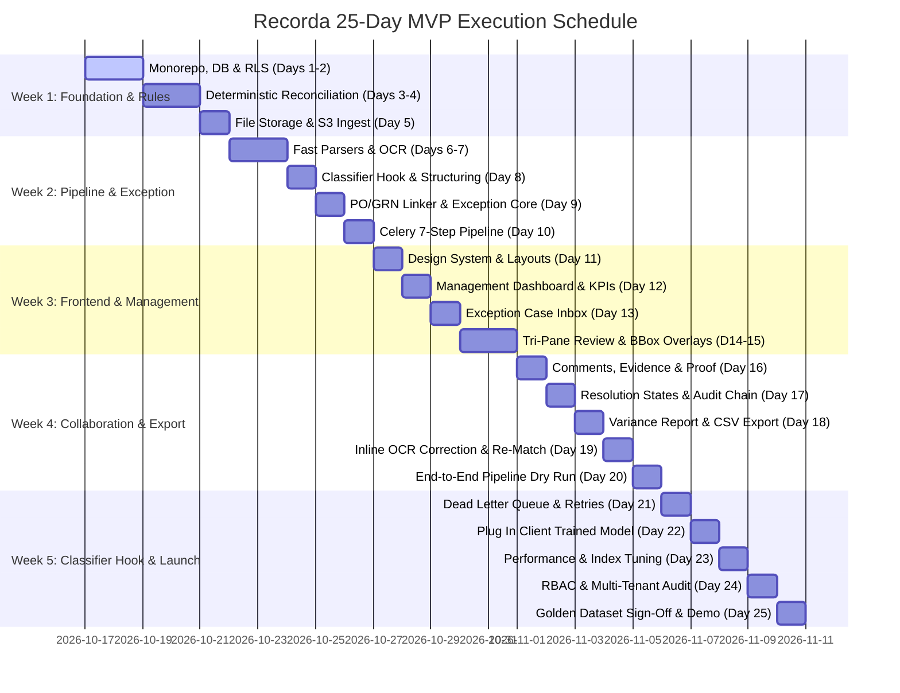

# Recorda – 25-Day Implementation Roadmap

**Version:** 2.0 (Updated Execution Plan)  
**Target Duration:** 25 Working Days (MVP Delivery)  
**Product Scope:** Three-way reconciliation & exception management (PO vs GRN vs Invoice) in **PKR (Rs.)**  
**ML Boundary:** Machine Learning is strictly confined to **document classification** (*Text $\rightarrow$ TF-IDF $\rightarrow$ Classifier*). The classification model is trained by the client on their custom dataset. Recorda engineering provides the pluggable interface, inference adapter, and manual fallback UI.

---

## 25-Day Phased Architecture

---

## Detailed Day-by-Day Implementation Plan

### Week 1: Core Foundation, Schema & Deterministic Rules (Days 1 – 5)

#### Day 1: Project Scaffolding & Monorepo Setup
- Initialize repository structure (`apps/web`, `apps/api`, `apps/worker`, `packages/reconciliation`, `packages/domain`).
- Docker Compose configuration:
  - PostgreSQL 16 (with `pg_trgm` enabled)
  - Redis 7 (broker + cache)
  - MinIO (local S3-compatible document storage)
- Configure Python 3.12 (uv/poetry) and Next.js 14 / TypeScript (pnpm).
- **Deliverable:** Working `docker-compose up` with container health checks.

#### Day 2: PostgreSQL Schema, RLS & Exception Case Model
- Write Alembic migrations:
  - `organizations`, `users`, `cases`, `documents`, `extracted_fields`, `line_items`.
  - `exceptions` (`id` format `EX-XXXX`, `status`, `owner_department`, `amount_under_review` in `NUMERIC(18,4)` PKR, `po_present`, `grn_present`, `invoice_present`).
  - `exception_comments`, `assignments`, `audit_events`.
- Implement Row-Level Security (RLS) policies by `org_id`.
- **Deliverable:** Verified database schema with automated migration tests.

#### Day 3: Deterministic Reconciliation Engine (`packages/reconciliation`)
- Build pure Python reconciliation module using `Decimal` arithmetic:
  - Quantity Rules: Short Delivery (Stores received < PO ordered) and Overbilling (Invoiced > Stores received).
  - Price Rules: Invoice Unit Price vs PO Unit Price against configurable percentage tolerance.
  - Document Integrity Rules: Missing GRN verification, Missing PO reference.
  - Duplicate Invoice Rule: Fast hash + invoice number + supplier match.
- **Deliverable:** Standalone reconciliation package with zero external network dependencies.

#### Day 4: Unit Test Suite & Edge Case Matrix
- Test suite with 100% rule coverage:
  - The Core Example: PO = 500 units, GRN = 450 units, Invoice = 500 units $\rightarrow$ Flag 50 units unreceived overbill.
  - Fractional prices and PKR rounding.
  - Multiple Goods Received Notes (partial shipments) matching a single PO.
  - Duplicate invoice submission rejection.
- **Deliverable:** Comprehensive `pytest` test suite passing with full assertions.

#### Day 5: File Ingestion & Storage Service
- Implement S3/MinIO upload service with short-lived pre-signed URLs (15-min expiry).
- Implement SHA-256 file fingerprinting on ingest to block duplicate uploads.
- Implement MIME-type validator (PDF, TIFF, PNG, JPG, XLSX, CSV).
- Log immutable `DOCUMENT_INGESTED` event.
- **Deliverable:** Operational `/v1/uploads` endpoint returning pre-signed URLs.

---

### Week 2: Extraction, Pluggable Classifier & Pipeline (Days 6 – 10)

#### Day 6: Document Parsers (Native PDF & Excel)
- `NativePdfParser`: High-speed text and layout extraction via PyMuPDF for digital text PDFs.
- `ExcelParser`: Tabular extraction via openpyxl/pandas for supplier spreadsheets.
- Normalize page geometry to bounding box coordinates $[x_0, y_0, x_1, y_1]$ in $[0, 1000]$.
- **Deliverable:** Sub-second parsing for clean digital documents.

#### Day 7: Scanned Document OCR & Bounding Box Extraction
- OCR adapter integration (AWS Textract / Azure Document Intelligence / PaddleOCR fallback).
- Normalize word and table cell bounding boxes with confidence scores.
- **Deliverable:** Uniform coordinate output across both scanned and native documents.

#### Day 8: Pluggable Document Classification Hook & Heuristics
- Implement `DocumentClassifierInterface` abstract class:
  $$\text{Raw Text} \longrightarrow \text{TF-IDF Vectorizer} \longrightarrow \text{Classifier Model} \longrightarrow (\text{PO} \mid \text{GRN} \mid \text{INVOICE})$$
- Provide mock/heuristic adapter for development while the client trains their classifier.
- Add manual reclassification override endpoint if confidence $< 80\%$.
- Field arithmetic checks: $\text{Qty} \times \text{Unit Price} = \text{Line Total}$ and $\sum \text{Line Totals} = \text{Invoice Total}$.
- **Deliverable:** Functional classification hook and arithmetic validator.

#### Day 9: Document Linker & Exception Case Generator
- Connect documents into cases using the PO Reference number (e.g. `PO-44819`).
- Build Exception Case generator:
  - If discrepancy detected: automatically instantiate `EX-XXXX`.
  - Calculate `amount_under_review` in PKR (Rs.).
  - Auto-assign initial owner: Stores for short deliveries; Finance for price/duplicate variances; Procurement for unlinked POs.
- **Deliverable:** Automatic creation and owner routing of Exception Cases.

#### Day 10: Celery 7-Step Pipeline Orchestration
- Build Celery task canvas executing the 7-step workflow:
  $$\text{Ingest} \longrightarrow \text{Understand} \longrightarrow \text{Structure} \longrightarrow \text{Connect} \longrightarrow \text{Reconcile} \longrightarrow \text{Manage} \longrightarrow \text{Resolve}$$
- Separate queues: `ingest`, `ml-classify`, `ocr`, `default`.
- Idempotency guard: Prevent re-running completed stages on task retry.
- **Deliverable:** Full automated pipeline execution from upload to active exception.

---

### Week 3: Frontend & Management Cockpit (Days 11 – 15)

#### Day 11: Frontend Shell & Design System
- Setup Next.js 14 App Router with Tailwind CSS and shadcn/ui.
- Theme tokens: Slate/Zinc neutral dark & light modes.
- Role-based navigation layout (Procurement, Stores, Finance, Management).
- Configure TanStack Query client.
- **Deliverable:** Responsive, modern application shell.

#### Day 12: Executive Management Dashboard (`/dashboard`)
- Build executive KPI cards:
  - Total Capital Under Review in PKR (`Rs. 2,450,000`).
  - Open Exceptions vs Resolved Exceptions count.
  - Transactions Reconciled count.
  - Mean Time to Resolution (MTTR in hours).
- Visual department bottleneck breakdown: Stores vs Finance vs Procurement.
- ML Classifier health metrics card: Accuracy, Precision, Recall, F1, Confusion Matrix.
- **Deliverable:** Management dashboard with real-time KPI data.

#### Day 13: Exception Case Inbox (`/exceptions`)
- Filterable table of active Exception Cases:
  - Filter by Department Owner (`Stores`, `Finance`, `Procurement`).
  - Filter by Status (`New`, `Under Review`, `Pending Evidence`).
  - Sort by Amount Under Review (PKR).
- Visual Evidence Checklist badges: `PO [✓]`, `GRN [✓]`, `Invoice [✓]`.
- **Deliverable:** Fully functional exception inbox table.

#### Day 14: Tri-Pane Review Workspace – PDF Viewer (`/exceptions/:id`)
- Embed `react-pdf` with zoom, pan, and page navigation.
- Render SVG/Canvas bounding box overlays directly over extracted values.
- Color-coded tabs: Blue (PO), Amber (GRN), Purple (Invoice).
- **Deliverable:** High-performance document viewer with coordinate overlays.

#### Day 15: 3-Way Reconciliation Matrix & Facts Panel
- Side-by-side reconciliation table aligning PO vs GRN vs Invoice line items.
- Visual discrepancy chips (e.g. `Short 50 units`, `+Rs. 40/unit price variance`).
- Clicking any cell highlights the matching bounding box on the original document.
- **Deliverable:** Interactive comparison table linked with the document viewer.

---

### Week 4: Collaboration, Resolutions & Auditability (Days 16 – 20)

#### Day 16: Collaborative Investigation Thread & Proof Attachments
- Build comment and evidence component on the Exception Case view:
  - Stores clerks attach delivery gate notes, weighbridge slips, or trucker notes.
  - Finance posts notes regarding supplier credit inquiries.
  - Mention teammates and log timestamps.
- **Deliverable:** Real-time collaborative investigation log on every exception.

#### Day 17: Defined Resolution States & Immutable Audit Trail
- Implement Resolution Action modal:
  - `RESOLVED - ACCEPTED` (Approved variance within business limits).
  - `RESOLVED - CREDIT NOTE` (Supplier credit note reference captured).
  - `RESOLVED - RE-INVOICED` (Supplier corrected invoice attached).
  - `REJECTED` (Invoice disputed and cancelled).
- Implement append-only `audit_events` logging with SHA-256 hash chaining.
- **Deliverable:** Compliant, auditable resolution workflow.

#### Day 18: Audit Report & CSV Export Engine
- PDF Report Generator:
  - Summary page featuring Exception Case ID, PO reference, parties, 3-way table, attached proofs, and resolution signature.
- CSV / JSON Export:
  - Formatted for accounting and ERP ingestion.
- **Deliverable:** Single-click audit package download.

#### Day 19: Inline OCR Correction & Instant Re-Reconciliation
- Popover modal to correct misread OCR digits directly on the review screen.
- Log change to `audit_events` with previous value, new value, user ID, and reason.
- Immediately re-run reconciliation rules without re-running OCR.
- **Deliverable:** Sub-second correction workflow for false OCR misreads.

#### Day 20: Full End-to-End System Dry Run
- Complete pipeline run on sample POs, GRNs, and Invoices.
- Verify creation of `EX-1048` for the 500 / 450 / 500 mismatch with amount in PKR.
- **Deliverable:** Fully connected and verified end-to-end prototype.

---

### Week 5: Classifier Integration, Hardening & Launch (Days 21 – 25)

#### Day 21: Dead-Letter Queue (DLQ) & Error Resilience
- Implement Celery exponential backoff retries with jitter for OCR/storage calls.
- Route unparseable or corrupted files to Dead-Letter Queue with visible user alerts.
- Single-click "Retry Ingest" action for operators.
- **Deliverable:** Zero silent failures; fault-tolerant worker pool.

#### Day 22: Integrate Client's Trained Classifier Model
- Replace mock classifier with the client's trained model adapter:
  - Connect to user's classification inference endpoint (REST, ONNX, or Python module).
  - Output validation: `PO`, `GRN`, `INVOICE`.
  - Confidence threshold check: Route documents $< 80\%$ confidence to manual user tagging.
- Run test batch to calculate Accuracy, Precision, Recall, and Confusion Matrix.
- **Deliverable:** Production deployment of the user's custom classification model.

#### Day 23: Performance Benchmarking & Database Optimization
- Validate sub-60-second processing target for a 3-document case.
- Tune PostgreSQL indexes:
  - `(org_id, po_number)`
  - `(org_id, status)`
  - `(amount_under_review DESC)`
- Connection pool tuning for FastAPI and Celery.
- **Deliverable:** Benchmarked high-throughput pipeline.

#### Day 24: Security Audit & Role-Based Access Control (RBAC)
- Audit permission boundaries:
  - `Stores` can verify GRNs and add receiving notes, but cannot approve credit resolutions.
  - `Finance` can issue credit note resolutions and approve payouts.
  - `Management` can reassign cases and view macro KPIs.
- Verify tenant data isolation using PostgreSQL RLS policies.
- **Deliverable:** Security-cleared system build.

#### Day 25: Golden Dataset Sign-Off & Demonstration
- Run full golden test dataset:
  - Confirm 100% recall on quantity shortages and overbilling.
  - Confirm zero automated payment or silent approval paths.
- Prepare deployment documentation and runbooks.
- **Deliverable:** **Recorda MVP Definition of Done achieved.**
