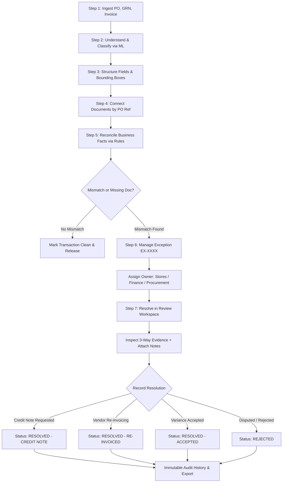

# Recorda – User Flows & Wireframes Specification

**Version:** 2.0 (Updated UX & UI Specification)  
**Core Model:** Exception Case Management (`EX-XXXX`)  
**Currency:** Pakistani Rupees (Rs. / PKR)  
**Key References:** [Recorda Requirements](file:///c:/Users/AKUWAT/Documents/GitHub/Recorda/Recorda%20%E2%80%93%20Requirements%20&%20Pipeline.md) · [Recorda Architecture](file:///c:/Users/AKUWAT/Documents/GitHub/Recorda/Recorda%20%E2%80%93%20System%20Architecture%20Design.md)

---

## 1. Stakeholder Roles & UX Perspectives

Recorda delivers specialized interfaces addressing each stakeholder's core business question:

| Role | Core Question | Focus & Action in Recorda |
| :--- | :--- | :--- |
| **Procurement** | *"What did we order?"* | Reviews original PO specifications, verifies contracted supplier rates, addresses price variance exceptions. |
| **Stores** | *"What actually arrived?"* | Checks warehouse receipt counts on the Goods Received Note (GRN), documents short shipments or damaged crates, attaches receiver notes. |
| **Finance** | *"What are we being billed for?"* | Inspects vendor invoices against receipts, requests credit notes for billed unreceived items, applies resolution states. |
| **Management** | *"What is still unresolved?"* | Evaluates operational bottleneck KPIs, monitors total capital at risk in PKR (Rs.), monitors ML classifier accuracy. |

---

## 2. End-to-End User Flow (7 Steps)



---

## 3. UI Wireframes

### Screen 1: Executive & Management Dashboard (`/dashboard`)

```
+-----------------------------------------------------------------------------------------------------------------------+
|  RECORDA   |  [Dashboard]   [Exceptions (18)]   [Documents]   [Suppliers]   [Audit Log]         (Org: Atlas Corp) [User v] |
+-----------------------------------------------------------------------------------------------------------------------+
|  MANAGEMENT OVERVIEW                                                                             Period: [ Last 30 Days v ]|
|                                                                                                                       |
|  EXECUTIVE KPIS:                                                                                                      |
|  +---------------------+   +---------------------+   +---------------------+   +---------------------+                |
|  | AMOUNT UNDER REVIEW |   | OPEN EXCEPTIONS     |   | TRANSACTIONS CHECKED|   | AVG RESOLUTION TIME |                |
|  | Rs. 2,450,000       |   | 18 Cases            |   | 1,420 Reconciled    |   | 18.4 Hours          |                |
|  | 12 Stores / 6 Fin   |   | (4 Critical Overbill|   | (91.2% Clean)       |   | (-4.2 hrs vs last m)|                |
|  +---------------------+   +---------------------+   +---------------------+   +---------------------+                |
|                                                                                                                       |
|  DEPARTMENTAL BOTTLENECK ANALYSIS:                                                                                    |
|  +----------------------------------------------------+  +----------------------------------------------------------+ |
|  | Exceptions by Department                           |  | ML Document Classifier Health (Last Batch: 500 docs)     | |
|  | Stores (GRN Shortages):     ████████████ (12)      |  | Accuracy:  96.4%   |   Precision: 95.8%                      | |
|  | Finance (Price Variances):  ██████ (6)             |  | Recall:    97.1%   |   F1 Score:  96.4%                      | |
|  | Procurement (Unlinked PO):  ██ (2)                 |  | Confusion: PO (150/150) | GRN (146/150) | INV (198/200)      | |
|  +----------------------------------------------------+  +----------------------------------------------------------+ |
|                                                                                                                       |
|  CRITICAL CAPITAL AT RISK:                                                                                            |
|  - EX-1048 | Apex Ltd        | Rs. 125,000 | Stores (Short Delivery: 50 units billed unreceived)  | [Open Case]       |
|  - EX-1052 | FastenBolt Corp | Rs. 42,000  | Finance (Price Variance: +15% over contracted rate)  | [Open Case]       |
+-----------------------------------------------------------------------------------------------------------------------+
```

---

### Screen 2: Exception Case Inbox (`/exceptions`)

```
+-----------------------------------------------------------------------------------------------------------------------+
|  RECORDA   |  Exceptions Inbox                                                         [+ Ingest Batch]  [Filter v]   |
+-----------------------------------------------------------------------------------------------------------------------+
|  Department View: [* All ] [ Stores (12) ] [ Finance (6) ] [ Procurement (2) ]     Status: [ Open Cases v ]           |
|                                                                                                                       |
|  +-----------------------------------------------------------------------------------------------------------------+  |
|  | CASE ID  | PO REF    | SUPPLIER        | TYPE                 | OWNER    | AT-RISK (PKR)| CHECKLIST | ACTIONS   |  |
|  |----------|-----------|-----------------|----------------------|----------|--------------|-----------|-----------|  |
|  | EX-1048  | PO-44819  | Apex Logistics  | Quantity Overbill    | Stores   | Rs. 125,000  | [P][G][I] | [Resolve] |  |
|  | EX-1049  | PO-44820  | Indus Paper Co  | Price Variance       | Finance  | Rs. 38,500   | [P][G][I] | [Resolve] |  |
|  | EX-1050  | PO-44825  | Pak Fasteners   | Missing GRN (No slip)| Stores   | Rs. 210,000  | [P][ ][I] | [Resolve] |  |
|  | EX-1051  | PO-44831  | Crescent Steel  | Duplicate Invoice    | Finance  | Rs. 450,000  | [P][G][I] | [Resolve] |  |
|  | EX-1052  | PO-44834  | Orient Pack     | Calculation Error    | Finance  | Rs. 9,200    | [P][G][I] | [Resolve] |  |
|  +-----------------------------------------------------------------------------------------------------------------+  |
|  Checklist Legend: [P] = Purchase Order Verified  [G] = Goods Received Note Verified  [I] = Supplier Invoice Verified  |
+-----------------------------------------------------------------------------------------------------------------------+
```

---

### Screen 3: The Exception Resolution & Tri-Pane Review Workspace (`/exceptions/EX-1048`)

```
+-----------------------------------------------------------------------------------------------------------------------+
| [< Back to Inbox]  EXCEPTION CASE: EX-1048 | PO-44819 | Apex Logistics | Amount Under Review: Rs. 125,000.00         |
+-----------------------------------------------------------------------------------------------------------------------+
|  CASE STATUS: [ UNDER REVIEW ]   OWNER: [ Stores (Assigned to: Tariq M.) v ]   EVIDENCE: PO [✓]  GRN [✓]  INVOICE [✓] |
+-----------------------------------------------------------------------------------------------------------------------+
|  LEFT PANE: DOCUMENT VIEWER (45%)             | RIGHT PANE: 3-WAY RECONCILIATION & CASE MANAGEMENT (55%)             |
|                                               |                                                                       |
|  Tabs: [* GRN-8812 (Stores)] [ INV ] [ PO ]   |  RECONCILIATION FACTS:                                                |
|  Page [ 1 / 1 ]   Zoom: [-] [100%] [+]        |  +------------------------------------------------------------------+ |
|  +------------------------------------------+ |  | ITEM: Industrial Gearbox (SKU: GB-99)                             | |
|  | GOODS RECEIVED NOTE: GRN-8812            | |  | PO Ordered:    500 units @ Rs. 2,500                              | |
|  | Warehouse: Karachi South                 | |  | Stores Recv:   450 units (Verified by Gate Inward Stamp)          | |
|  | Received Date: Oct 14, 2026              | |  | Invoiced:      500 units @ Rs. 2,500                              | |
|  |                                          | |  | ---------------------------------------------------------------- | |
|  | Item: GB-99                              | |  | EXCEPTION: 50 Units Billed Without Goods Delivery (Rs. 125,000)   | |
|  | Qty Received: 450*                       | |  +------------------------------------------------------------------+ |
|  | +--------------------------------------+ | |                                                                       |
|  | | [HIGHLIGHTED AMBER BOX: BBOX #4]     | | |  INVESTIGATION NOTES & COLLABORATIVE EVIDENCE:                        |
|  | | Hand-written note: "Short 50 crates" | | |  +------------------------------------------------------------------+ |
|  | +--------------------------------------+ | |  | Stores (Tariq M. - 10:14 AM):                                     | |
|  | Receiver Signature: Tariq M. (Stores)    | |  | "Driver stated 50 units were damaged in transit. We signed delivery| |
|  +------------------------------------------+ |  | receipt for 450 units only. Gate register attached." [slip.pdf] | |
|                                               |  | Finance (Amina K. - 11:30 AM):                                    | |
|                                               |  | "Supplier accounts contacted. Requested credit note for Rs.125K"  | |
|                                               |  +------------------------------------------------------------------+ |
|                                               |  [+ Add Comment or Attach Proof Note...]                              |
|                                               |                                                                       |
|                                               |  RECORD RESOLUTION:                                                   |
|                                               |  [ Reassign Owner v ]    [ Request Credit Note ]    [ Settle / Close v ]
+-----------------------------------------------------------------------------------------------------------------------+
```

---

### Screen 4: Resolution Action Modal

```
+-----------------------------------------------------------------+
|  Resolve Exception Case: EX-1048                            [X] |
+-----------------------------------------------------------------+
|  Resolution Type:                                               |
|  ( ) RESOLVED - ACCEPTED (Legitimate approved tolerance)        |
|  (*) RESOLVED - CREDIT NOTE (Supplier issued credit for diff)   |
|  ( ) RESOLVED - RE-INVOICED (Supplier cancelled and re-billed)  |
|  ( ) REJECTED (Transaction cancelled, payment blocked)          |
|                                                                 |
|  Credit Note Reference:   [ CN-2026-904                       ] |
|  Credit Amount:           [ Rs. 125,000.00                    ] |
|                                                                 |
|  Resolution Rationale / Note:                                   |
|  +------------------------------------------------------------+ |
|  | Supplier acknowledged 50 damaged units. Credit note       | |
|  | CN-2026-904 received for Rs. 125,000. Invoice released for| |
|  | adjusted payment of Rs. 1,125,000.                         | |
|  +------------------------------------------------------------+ |
|                                                                 |
|  [ Cancel ]                                 [ Save Resolution ] |
+-----------------------------------------------------------------+
```

---

### Screen 5: Inline OCR Field Correction

```
+-----------------------------------------------------------------+
|  Correct Extracted Field Value                              [X] |
+-----------------------------------------------------------------+
|  Document:           Goods Received Note (GRN-8812)             |
|  Field:              Line Item 1 -> Quantity Received           |
|  Current OCR Value:  480 (Confidence: 68%)                      |
|                                                                 |
|  Corrected Value:    [ 450                                    ] |
|  Reason for Edit:    [ Dropdown: Misread Digits by OCR       v] |
|  Reviewer Note:      [ Clearly stamped as 450 on inward copy  ] |
|                                                                 |
|  [!] Audit Notice: This edit will append an immutable audit     |
|      event recording previous value (480) and new value (450).  |
|                                                                 |
|  [ Cancel ]                            [ Update & Re-Reconcile ] |
+-----------------------------------------------------------------+
```
